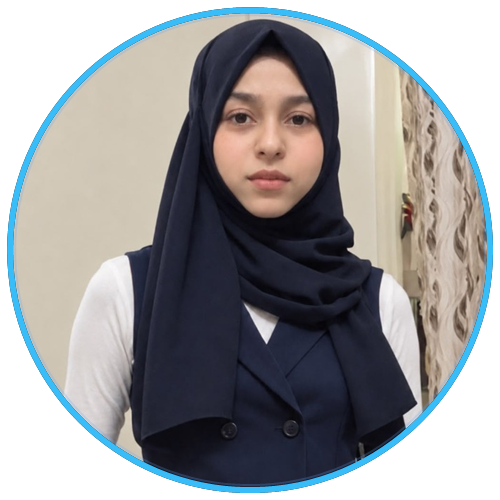

<div align="center">

<!-- Header Wavy Gradient Banner -->


<br/>

<!-- Profile Avatar (Framed Circular Portrait) -->
<table border="0">
  <tr>
    <td align="center">
      <a href="https://github.com/shifasiddiqu30">
        
      </a>
    </td>
  </tr>
</table>

<!-- Animated Typing Subtitle -->
<a href="https://github.com/shifasiddiqu30">
  
</a>

<p align="center">
  <em>Driven by curiosity, fueled by code, and dedicated to engineering clean digital experiences.</em>
</p>

<!-- Quick Action Badges -->
<p align="center">
  <a href="https://www.linkedin.com/in/shifa-siddiqui-79617a383" target="_blank">
    
  </a>
  &nbsp;
  <a href="https://shifasiddiqu30.github.io/shifa-portfolio/" target="_blank">
    
  </a>
  &nbsp;
  <a href="https://github.com/shifasiddiqu30" target="_blank">
    
  </a>
</p>

</div>

---

### 💫 About Me

```yaml
name: Shifa Siddiqui
role: Computer Engineering Student
focus: Full-Stack Web Development & Java Software Systems
current_interests: [Data Structures & Algorithms, QA Automation, System Design]
open_for: [Internships, Software Engineering Roles, Open Source Collaborations]
motto: "Keep Learning. Keep Building. Keep Growing."
```

Hello and welcome to my GitHub profile! 👋

I am a **Computer Engineering student** and **aspiring Software Engineer** with a passion for transforming complex concepts into clean, functional, and visually engaging software. Whether it's architecting modular backend logic in **Java**, building responsive web applications with modern frontend technologies, or exploring robust testing methodologies through **QA Automation**, I thrive on writing maintainable and purposeful code.

* 🎓 **Academic Journey:** Pursuing Computer Engineering with a focus on core computer science foundations.
* 🌐 **Web Development:** Developing modern, mobile-first, and user-centric web applications.
* ☕ **Object-Oriented Programming:** Strong programming proficiency in **Java** and **C** with clean design patterns.
* 🧠 **Algorithmic Growth:** Actively practicing **Data Structures & Algorithms** to sharpen problem-solving efficiency.
* 🧪 **Quality Assurance:** Exploring **QA Automation** and end-to-end testing to ensure software reliability and test-driven excellence.
* 🚀 **Opportunities:** Open to software engineering internships, technical collaborations, and innovative student hackathons.

---

### 🛠️ Tech Stack & Tooling

<div align="center">

<!-- Skill Icons Visual Grid -->
<a href="https://skillicons.dev">
  
</a>

<br/><br/>

| Category | Technologies & Tools |
| :--- | :--- |
| **Languages** |      |
| **Testing & Quality** |   |
| **Version Control & Dev Tools** |    |

</div>

---

### 📂 Featured Projects

<table>
  <tr>
    <td width="50%" valign="top">
      <h3 align="left">🌐 Personal Portfolio Website</h3>
      <p>A modern, fully responsive personal developer portfolio showcasing technical skillsets, academic background, featured software engineering projects, and direct contact avenues.</p>
      <p>
        
        
        
      </p>
      <p>
        <a href="https://github.com/shifasiddiqu30/shifa-portfolio">
          
        </a>
        <a href="https://shifasiddiqu30.github.io/shifa-portfolio/">
          
        </a>
      </p>
    </td>
    <td width="50%" valign="top">
      <h3 align="left">🎓 Nexa Academy</h3>
      <p>A smart, comprehensive e-learning platform engineered with React and Vite. Features interactive course directories, downloadable study materials, recorded lectures, test modules, and an administrative dashboard.</p>
      <p>
        
        
        
      </p>
      <p>
        <a href="https://github.com/shifasiddiqu30/Nexa-Academy">
          
        </a>
      </p>
    </td>
  </tr>
  <tr>
    <td width="50%" valign="top">
      <h3 align="left">🏫 College Management System</h3>
      <p>An academic enterprise management application implemented in Java. Handles student registration, course tracking, faculty records, and academic reporting using modular Object-Oriented principles.</p>
      <p>
        
        
        
      </p>
      <p>
        <a href="https://github.com/shifasiddiqu30/College-Management-System">
          
        </a>
      </p>
    </td>
    <td width="50%" valign="top">
      <h3 align="left">🚆 RailX.ai / TrainX</h3>
      <p>A hackathon-engineered intelligent transit assistant providing smart railway route optimization, live train schedule updates, passenger assistance, and an intuitive travel planning experience.</p>
      <p>
        
        
        
      </p>
      <p>
        <a href="https://github.com/shifasiddiqu30/RailX.ai">
          
        </a>
      </p>
    </td>
  </tr>
  <tr>
    <td colspan="2" valign="top">
      <h3 align="left">☕ L&L Cafe Website</h3>
      <p>An elegant, responsive cafe website crafted with modern web standards. Features interactive culinary menu exploration, seamless table reservation booking, special promotional showcases, and aesthetic brand styling.</p>
      <p>
        
        
        
      </p>
      <p>
        <a href="https://github.com/shifasiddiqu30/LL-Cafe-Website">
          
        </a>
      </p>
    </td>
  </tr>
</table>

---

### 📊 GitHub Analytics & Activity

<div align="center">

<table border="0">
  <tr>
    <td align="center" width="50%">
      
    </td>
    <td align="center" width="50%">
      
    </td>
  </tr>
  <tr>
    <td colspan="2" align="center">
      
    </td>
  </tr>
</table>

</div>

---

### 🤝 Connect With Me

<div align="center">

Feel free to connect, discuss software development, or collaborate on exciting projects!

<br/>

<a href="https://www.linkedin.com/in/shifa-siddiqui-79617a383" target="_blank">
  
</a>
&nbsp;&nbsp;
<a href="https://shifasiddiqu30.github.io/shifa-portfolio/" target="_blank">
  
</a>
&nbsp;&nbsp;
<a href="https://github.com/shifasiddiqu30" target="_blank">
  
</a>

</div>

<br/>

---

<div align="center">

<!-- Bottom Decorative Wavy Graphic -->


<p align="center">
  <strong>“Keep Learning. Keep Building. Keep Growing.”</strong>
</p>
<p align="center">
  <sub>Designed with precision for <strong>Shifa Siddiqui</strong> • © 2026</sub>
</p>

</div>
